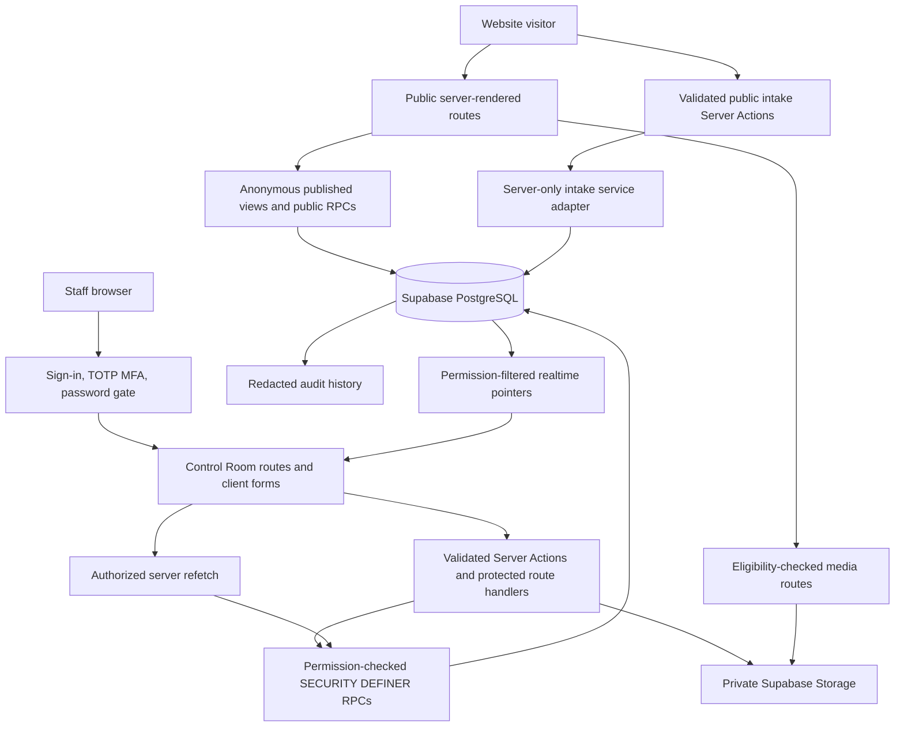
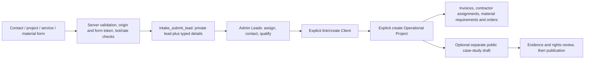

# RENZ architecture overview

**Source review: 23 October 2026.** This describes the application in this repository. An implemented route or a recorded local test is not evidence of a deployed or production-verified service. Use [current status](CURRENT_STATUS_AND_OPEN_ITEMS.md) and the [deployment handoff](DEPLOYMENT_HANDOFF.md) for the release boundary. Earlier dated phase reports remain historical evidence.

RENZ combines a public website with a private staff Control Room in one Next.js application. The official slogan is **Brick by Brick.** The public site reads approved publication snapshots; the Control Room manages the private business records and the drafts that produce those snapshots. A public case study and an operational project are separate records with deliberately different privacy rules.

## System map



The database is an enforcement boundary, not just persistence. Hiding a navigation entry does not grant or revoke access. Fresh permissions, active account state, AAL2 MFA and the temporary-password gate are checked again inside protected database functions.

## Code ownership and runtime

The exact dependency set is in [package.json](../package.json) and [pnpm-lock.yaml](../pnpm-lock.yaml): Next.js 16.4.1, React 19.2.8, TypeScript 6.0.3, Supabase JS 2.115.0, Supabase SSR 0.12.6 and pnpm 11.25.0. Node's accepted range is `>=24.18.0 <25`; runtime pins and verification requirements are described in the [environment guide](ENVIRONMENT_SETUP.md). These are repository pins, not a claim that this review reinstalled them.

| Location                                            | Responsibility                                                                          |
| --------------------------------------------------- | --------------------------------------------------------------------------------------- |
| `src/app/(public)/`                                 | Public page composition, route metadata, loading/error/404 behavior                     |
| `src/app/admin/(workspace)/`                        | Protected operational, finance, delivery, CMS, analytics and settings pages             |
| `src/app/admin/sign-in`, `mfa`, `security/password` | Authentication and first-password-change progression                                    |
| `src/app/api/`                                      | Upload/download boundaries, analytics recorder, health and scheduled-task endpoint      |
| `src/features/<domain>/`                            | Domain contracts, server reads, Server Actions and feature-specific components          |
| `src/features/website/`                             | Structured page CMS, registry, publication loaders, media library and layout rules      |
| `src/components/site/sections/`                     | Static map of allowed section renderers; shared public/draft-preview rendering          |
| `src/lib/auth/`                                     | Session guards, exact permission vocabulary, role explanations and action access        |
| `src/lib/supabase/`                                 | Separate browser, user-session server, anonymous public, Auth Admin and service clients |
| `src/lib/database/database.types.ts`                | Generated database contract; verify drift against a migrated local database             |
| `supabase/migrations/`, `supabase/tests/database/`  | Ordered schema/security changes and pgTAP contracts                                     |
| `scripts/`, `tests/`                                | Local lifecycle proofs, recovery/security tools and unit/component/browser suites       |
| `infra/cloudflare/notification-sweep/`              | Scheduler Worker source; presence does not establish cloud installation                 |

Routes compose server-loaded data. Interactive forms, navigation, gallery controls, media choices, charts and realtime refresh are client components where browser state is needed. Server-only imports keep database service credentials, Auth Admin operations, PDF generation and eligibility checks out of browser bundles. `src/proxy.ts` participates in session handling; protected layouts/actions and SQL remain the authorization owners.

## Routes and boundaries

Public routes include `/`, `/services`, `/services/[slug]`, `/projects`, `/projects/[slug]`, `/about`, `/insights`, `/insights/[slug]`, `/contact`, `/start-a-project`, `/start-a-project/success`, `/enquire/service`, `/enquire/materials`, legal routes and published custom `/<slug>` pages. The `/expertise` routes are legacy compatibility surfaces; inspect their redirect implementation before changing links. `/brand-study` is a historical preview surface, not the operational brand authority.

`/i/[token]` and `/po/[token]`, including their PDF routes, are token-scoped invoice and purchase-order document viewers outside the staff workspace. Possession of a valid share URL grants access to one document; it does not create a client account or open a CRM record. Draft website previews live under `/preview/website/[pageId]` and the content editors' `/preview` routes and require staff access.

The Admin separates **Operations** (leads, clients, operational projects, contractors and assignments), **Finance** (invoices and contractor payables), **Procurement** (suppliers, materials and orders), **Website** (pages, globals, footer, media, services, case studies and insights), **Analytics**, **Notifications** and **Settings**. The navigation is permission-filtered; the route itself still checks access.

## Authentication, permissions and data access

Supabase Auth stores identities and TOTP factors. `profiles` ties an Auth user to account status, display identity and `must_change_password`; `user_roles → roles → role_permissions → permissions` is the fresh authorization graph. A staff member signs in, verifies/enrols TOTP, then replaces any temporary password before protected facades answer. There is no public staff registration. Owner-created accounts use the narrow server-only Auth Admin adapter; the temporary password is disclosed once for private handover. Password-reset email delivery and cloud recovery require separate provider validation.

The six current templates are Owner/Super Admin, Admin, Project Manager, Finance, Content Editor and View Only. **C10 supersedes older two-role matrices:** Content Editor can publish editorial content and website pages, and Finance can void invoices. Admin can prepare content/page drafts but does not inherit those publication rights. Only the owner manages staff. Exact permissions, not the informal role description, determine an action; see [Admin guide](ADMIN_USER_GUIDE.md).

Operational tables use RLS and restricted grants. Narrow `SECURITY DEFINER` commands use an empty `search_path`, explicit checks and bounded outputs; internal helpers live in `private`. Public consumers use selected columns from `published_*` projections and public RPCs, not arbitrary table reads. The service client is limited to explicitly privileged server work such as screened intake, health/maintenance and authorized Auth operations; ordinary staff reads/writes retain the user's session. See [security model](SECURITY_MODEL.md) and [data relationships](DATA_MODEL_AND_RELATIONSHIPS.md).

## Public content and CMS publication

Pages are structured `website_pages` and ordered `website_page_sections`. The registry declares allowed fields, variants and system modules, and the static renderer map in `render-page.tsx` selects components. No stored component name, arbitrary HTML, CSS or JavaScript is executed. Publication creates a frozen `website_page_revisions.snapshot`; `published_revision_id` selects what a visitor receives through `public_website_page(path)`.

Services, public projects and posts have a parallel revision mechanism in `content_publications`. First publication uses `publish_record`; subsequent `republish_content` rechecks evidence/media/claims and freezes another snapshot. Public `published_services`, `published_projects`, `published_posts` and `published_project_media` read the current published snapshot. Live evidence/rights eligibility can still withdraw content. The Services adapter `getPublicServiceCategories` has **no static service fallback**: publishing or withdrawing a service changes all its public consumers.

```mermaid
sequenceDiagram
  participant Owner as Authorized publisher
  participant Editor as Website page editor
  participant SQL as CMS SQL facade
  participant DB as PostgreSQL
  participant Site as Public route
  Owner->>Editor: Edit section in a published page
  Editor->>SQL: Save validated fields with expected_version
  SQL->>DB: Check permission/version; update private draft
  SQL-->>Editor: New version or version_conflict
  Owner->>Editor: Preview draft and publish changes
  Editor->>SQL: publish_website_page(page, version, summary)
  SQL->>DB: Validate media; capture snapshot; select revision; audit
  Editor->>Site: Revalidate affected paths/layout
  Site->>DB: public_website_page(path)
  DB-->>Site: Last published snapshot
```

Page RPC reads use React request memoization without a persistent page cache in `src/features/website/data.ts`. Entity reads in `src/features/public-content/data.ts` still use tagged persistent caching, with a one-hour default revalidation window and explicit publish invalidation. Do not apply the old CR1 blanket statement that every public loader uses `unstable_cache`. Direct SQL/seed changes bypass application invalidation and require deliberate cache refresh/revalidation.

Restore copies a saved revision into a draft, then requires preview/publication. Content revision restore does not restore project media relationships; the Media tab remains authoritative. Slug changes create aliases resolved as permanent redirects. System routes, required functional sections, intake logic and registry types are protected from arbitrary owner removal. See [CMS guide](WEBSITE_CMS_GUIDE.md).

The Insights media path has a current implementation gap: the editor stores `posts.hero_asset_id`, but `InsightArticleView` and the article route do not pass it to the renderer. Article preview/publication and the Insights index use the fixed generated `InsightMedia` collection instead. Selecting/publishing a different hero cannot change those surfaces yet. The Insights index also inserts its film block/copy/poster/video directly in `InsightsIndexSection`, outside the section registry/configuration; owners cannot independently edit or hide it in the CMS. These are explicit limits to the owner-managed content claim, not completed media-authoring workflows.

## Media upload and delivery

`/api/admin/media` and `/api/admin/projects/media` call the shared server ingestion helper `uploadEditorialImage`. It sniffs signatures, enforces the actual upload limits (20 MiB overall and 12 MiB for video), generates image derivatives up to 2400 px and optional 960 px WebP thumbnails, computes SHA-256, uploads immutable UUID-rooted objects to private `editorial-originals`/`editorial-derivatives`, registers metadata and finalizes the upload. JPEG/PNG/WebP/AVIF and MP4/WebM are admitted by the current helper. Video is stored without transcoding; an image poster is needed for a good presentation. A registered object is not publication approval.

Rights, provenance, consent, review state and usage must be cleared separately. Website imagery may include labelled concepts; real-project evidence retains stricter eligibility. `/api/media/website/[mediaAssetId]`, `/api/media/project/[projectMediaId]` and brand media routes resolve eligibility or an authorized staff preview before private Storage delivery. The website route signs with the server credential only after that check and redirects to a five-minute Storage URL; it does not proxy the bytes. Raw bucket paths are not the public content query contract. Local assets under `public/` and CMS Storage objects have different recovery paths; Git alone does not contain uploaded Storage objects.

## Leads into business operations



These conversion steps are implemented commands, not automatic consequences of form submission. Intake is conditional on published intake settings, legal/consent and required anti-abuse configuration. Honeypot submissions deliberately return a plausible success without creating a lead. Accepted real submissions use idempotency keys; an authorized staff member uses `convert_lead_to_client` and `create_project_from_lead`. A material enquiry can produce draft material requirements after client/project conversion; it cannot directly order stock or pay a supplier.

`operational_projects.client_id` is required. Its optional unique `public_case_study_id` points to `projects`; this bridge copies only staff-entered public-safe draft title/slug/locale, never private client contact, budget or notes. Uploads from a lead are not automatically project-gallery media.

## Finance, delivery and realtime

Invoices use the shared document model for Admin HTML, print, PDFKit PDF and token-scoped sharing. Issuing locks the invoice, validates dates/lines, assigns the official number and freezes issuer/client/project snapshots and totals. Issued financial fields and lines are immutable. Payments record external receipts, not an online payment gateway: effective payments reduce the balance; reversal preserves history. Concurrent payment writes lock the parent invoice to reject overpayment. Money is decimal and summaries stay separated by currency.

Contractors and suppliers are capabilities of `trade_partners`, allowing the same firm in both registers. Contractor assignments connect partners to operational projects; assignment adjustments and contractor payments are separate from customer invoice payments. Procurement connects project requirements to purchase-order lines and reversible delivery receipts. Issued orders freeze document snapshots and have hash-only revocable supplier shares. This is a procurement workflow, not a stock valuation/accounting ledger.

Domain mutations audit and emit small `realtime_events` pointers: entity type/id/action/time, not business bodies or tokens. Permission-filtered subscriptions trigger authorized server refetches through the existing facades. Pinned form versions and controlled local drafts prevent a background refresh from silently overwriting an open edit. Realtime is invalidation, not a second data source; reconnect/focus/manual refresh must remain usable.

## Analytics, scheduled work and operations

Analytics derives operational and per-currency finance summaries from authoritative data. Website counters use `website_analytics_daily` with bounded event data; provider analytics is conditional on configuration/consent and is not proof of an active provider. Notifications are in-app, permission-selected and recipient-scoped; no staff notification email/browser-push service is established by this code.

Event-driven notifications run with business changes. Timed alerts require `run_notification_sweep`: the protected `POST /api/tasks/notifications-sweep` endpoint or operator script. Cloudflare Worker source supplies hourly scheduling; provider execution is unverified until deployed and rehearsed. Expired unsubmitted intake uploads have a separate operator report/purge script. Overdue invoice/order state is derived at read time and does not need a scheduler. See [scheduled tasks](RENZ_R1_SCHEDULED_TASKS.md).

`audit_logs` records actors, stable references, actions/outcomes and bounded redacted metadata; notes, passwords, share tokens and contact bodies must not enter it. Per-record Activity panels and permission-gated recent activity expose history. Health, deployment log review, backup and incident procedures are separate operational tools, not evidence that monitoring is installed.

The intended topology is GitHub → Netlify application → isolated Supabase environments, with Cloudflare DNS/Turnstile/optional analytics and the scheduler Worker as approved configuration permits. Hosting, domain/HTTPS, SMTP, anti-abuse, object backup and restore, scheduler and production performance require independent staging proof. This document performs no deployment. Preserve the authoritative [production runbook](RENZ_PRODUCTION_DEPLOYMENT.md), [backup/restore](RENZ_BACKUP_RESTORE.md), [rollback](RENZ_ROLLBACK.md) and [incident response](RENZ_INCIDENT_RESPONSE.md).

## Evidence and further reading

The descriptions above were checked against current route files, feature contracts/actions/loaders, generated types and the ordered S3–C10/CR1/D1.6/D1.7 migrations. Relevant regression sources include `tests/e2e/c4-control-room.spec.ts`, `c5-finance.spec.ts`, `c6-delivery.spec.ts`, `c8-intake.spec.ts`, `c9-intelligence.spec.ts`, `c10-staff-access.spec.ts`, `cr1-owner-cms.spec.ts` and `supabase/tests/database/`. This source review alone does not claim those suites were rerun; use the dated [testing guide](TESTING_AND_QA_GUIDE.md) and migration report for executed results.

The detailed original contracts remain useful: [C4 architecture](CLAUDE_C4_CONTROL_ROOM_ARCHITECTURE.md), [C5 finance](CLAUDE_C5_FINANCE_ARCHITECTURE.md), [C6 delivery](CLAUDE_C6_DELIVERY_ARCHITECTURE.md), [C8 leads](CLAUDE_C8_LEAD_ARCHITECTURE.md), [C9 intelligence](CLAUDE_C9_ANALYTICS_ARCHITECTURE.md) and [Owner CMS](CLAUDE_OWNER_CMS_ARCHITECTURE.md). Read them with the dated current-source corrections above.
