# RENZ data model and relationships

**Source review: 23 October 2026.** The ordered SQL in [`supabase/migrations/`](../supabase/migrations/) is the schema authority; [`database.types.ts`](../src/lib/database/database.types.ts) is the generated application contract. This is a domain map, not a replacement for constraints, function bodies or RLS tests. In particular, later migrations replace earlier functions and views: reading the first definition alone gives the wrong model.

All table names below are in `public` unless a schema is specified. `public` is the PostgreSQL schema name; it does **not** mean a table is anonymously readable. Private business tables have RLS/restricted grants and are reached through authorized facades. See [architecture](ARCHITECTURE_OVERVIEW.md) and [security model](SECURITY_MODEL.md).

## Relationship map

The diagram shows real foreign keys. It omits most attribution keys and localization/evidence/history tables to stay readable. `content_publications.target_id`, notification entity pointers and realtime pointers are intentionally not drawn as foreign keys: they use a type/id discriminator instead.

```mermaid
erDiagram
  AUTH_USERS ||--o| PROFILES : identity
  PROFILES ||--o{ USER_ROLES : memberships
  ROLES ||--o{ USER_ROLES : template
  ROLES ||--o{ ROLE_PERMISSIONS : grants
  PERMISSIONS ||--o{ ROLE_PERMISSIONS : capability
  PROFILES ||--o{ NOTIFICATIONS : recipient
  CLIENTS ||--o{ OPERATIONAL_PROJECTS : owns
  CLIENTS o|--o{ LEADS : converted_client
  OPERATIONAL_PROJECTS o|--o| LEADS : converted_project
  PROJECTS o|--o| OPERATIONAL_PROJECTS : optional_case_study
  SERVICES ||--o{ PROJECT_SERVICES : related_service
  PROJECTS ||--o{ PROJECT_SERVICES : public_relationship
  PROJECTS ||--o{ PROJECT_MEDIA : gallery
  MEDIA_ASSETS ||--o{ PROJECT_MEDIA : asset
  WEBSITE_PAGES ||--o{ WEBSITE_PAGE_SECTIONS : draft_sections
  WEBSITE_SECTION_TYPES ||--o{ WEBSITE_PAGE_SECTIONS : registry_type
  WEBSITE_PAGES ||--o{ WEBSITE_PAGE_REVISIONS : snapshots
  CLIENTS ||--o{ INVOICES : billed_client
  OPERATIONAL_PROJECTS o|--o{ INVOICES : optional_project
  INVOICES ||--o{ INVOICE_LINE_ITEMS : lines
  INVOICES ||--o{ INVOICE_PAYMENTS : receipts
  INVOICES ||--o{ INVOICE_SHARE_LINKS : revocable_shares
  TRADE_PARTNERS ||--o{ CONTRACTOR_ASSIGNMENTS : contractor
  OPERATIONAL_PROJECTS ||--o{ CONTRACTOR_ASSIGNMENTS : engagement
  CONTRACTOR_ASSIGNMENTS ||--o{ CONTRACTOR_PAYMENTS : money_out
  OPERATIONAL_PROJECTS ||--o{ PROJECT_MATERIAL_REQUIREMENTS : requires
  MATERIALS o|--o{ PROJECT_MATERIAL_REQUIREMENTS : optional_catalog
  TRADE_PARTNERS ||--o{ PURCHASE_ORDERS : supplier
  OPERATIONAL_PROJECTS ||--o{ PURCHASE_ORDERS : ordered_for
  PURCHASE_ORDERS ||--o{ PURCHASE_ORDER_LINE_ITEMS : lines
  PROJECT_MATERIAL_REQUIREMENTS o|--o{ PURCHASE_ORDER_LINE_ITEMS : optional_requirement
  PURCHASE_ORDERS ||--o{ PURCHASE_ORDER_RECEIPTS : deliveries
  PURCHASE_ORDER_RECEIPTS ||--o{ PURCHASE_ORDER_RECEIPT_ITEMS : received_items
  PURCHASE_ORDER_LINE_ITEMS ||--o{ PURCHASE_ORDER_RECEIPT_ITEMS : received_against
```



Required versus optional means a child foreign key is `NOT NULL` versus nullable. An entity may have zero children even where the child requires its parent. Uppercase labels above correspond to the lower-case SQL table names below; `AUTH_USERS` means `auth.users`.

## Identity and authority

| Tables                 | Relationships and invariants                                                                                                                                                                |
| ---------------------- | ------------------------------------------------------------------------------------------------------------------------------------------------------------------------------------------- |
| `profiles`             | `id` is both UUID primary key and FK to `auth.users.id`. Contains display name, account state, version and C10 `must_change_password`; it does not contain staff passwords or TOTP secrets. |
| `roles`, `permissions` | Smallint identity keys and unique textual `key`. System templates are `super_admin`, `admin`, `project_manager`, `finance`, `content_editor`, `viewer`.                                     |
| `user_roles`           | Composite PK `(user_id, role_id)`; required FKs to profile and role.                                                                                                                        |
| `role_permissions`     | Composite PK `(role_id, permission_id)`; required FKs to role and permission.                                                                                                               |

`private.has_permission(text)` requires an authenticated active profile, AAL2, `must_change_password = false` and an actual role-permission path. Revocation therefore affects subsequent protected calls even when a browser still shows an old screen. Last-active-Super-Admin triggers prevent removing/disabling the only active owner. Auth and profile lifecycle must be managed together through the supported staff actions.

C10 adds four templates and removes staff invitation/disable from Admin. It also grants publication and claim verification to Content Editor and invoice void to Finance. Older documents saying those actions are universally owner-only describe their earlier schema version. The [Admin guide](ADMIN_USER_GUIDE.md) explains the current templates; SQL permission rows remain authoritative.

## CRM and private projects

`clients` has UUID `id`, `full_name`, preserved email/phone display values, normalized search values, optional address/company/referral/reference, `client_tier`, version/attribution and `archived_at`. A normalized email or phone is required. Tiers are `standard | vip | premium`; tier is segmentation, while archive is lifecycle. Shared contact details produce possible-duplicate warnings rather than a uniqueness prohibition. `client_notes.client_id` is required; note bodies are private.

`operational_projects.client_id` is required and deletion-restricted. It stores the internal title/description, independent `status`, `current_phase`, `priority`, dates, optional budget/currency, version and archive state. Dates may be unknown; when both exist, end cannot precede start. Budget amount and currency must be present together; currency is a three-letter uppercase code. `operational_project_notes`, `operational_project_status_history` and `operational_project_phase_history` are required children. Status/phase histories use bigint identity ordering so multiple events in one transaction are ordered reliably.

`operational_projects.public_case_study_id` is nullable, unique and references `projects.id` with `ON DELETE SET NULL`. This is an optional one-to-one bridge to an editorial case study. `create_case_study_draft_from_operational_project` delegates to the existing public draft command using staff-entered title/slug/locale and links it. It never copies client identity, contact details, budget or internal notes. `admin_get_operational_project_for_case_study` checks operations-read permission before returning the reverse link.

## Editorial content, pages and media

| Tables                              | Meaning and relationships                                                                                                                                                                                                                                             |
| ----------------------------------- | --------------------------------------------------------------------------------------------------------------------------------------------------------------------------------------------------------------------------------------------------------------------- |
| `services`, `service_localizations` | Service identity/publication/order/optional hero plus localized wording. Localization PK `(service_id, locale)`; `(locale, slug)` unique. Later fields include scope, deliverables, exclusions, positioning, sub-services, use cases, process, coordination and FAQs. |
| `projects`, `project_localizations` | Public case studies/studies, not the private delivery record. Localized title/summary/narrative/SEO. Optional public-safe location, years, type, hero; later presentation fields include `evidence_class`, `layout_hint`, `home_featured`, materials and tags.        |
| `project_services`                  | Required project and service FKs join the public domains. A service relationship is not a link to an operational project.                                                                                                                                             |
| `project_stages`                    | Ordered editorial story chapters for a public project. They are different from `operational_projects.current_phase`.                                                                                                                                                  |
| `project_media`                     | UUID `id`, required `project_id` and `media_asset_id`, optional stage, role/order/version. Composite `(stage_id, project_id)` FK prevents attaching another project's stage. Localizations carry usage-specific alt/caption information.                              |
| `posts`, `post_localizations`       | Insight/article identity and localized article text/SEO. Optional author/hero and later related-service/topic/placement fields.                                                                                                                                       |
| `media_assets`                      | Private object metadata, checksum, bucket/path, dimensions/MIME/kind, source-asset derivation, provenance, rights/consent/reviewer and storage state. Later library metadata adds alt/caption/focal coordinates. Metadata is not the Storage object itself.           |
| `website_pages`                     | UUID page id, unique `page_key`/`path`, type `system                                                                                                                                                                                                                  | content                                                                                                                                | custom                                                                                                                                                                              | global`, draft settings/SEO/version and nullable `published_revision_id`. Publication state and selected revision must agree. |
| `website_page_sections`             | Required `page_id` and registry `section_type`, JSON `config`, order/version and bounded appearance/hidden/locked fields. Unique `(page_id, sort_order)` is deferrable for safe reorder.                                                                              |
| `website_section_types`             | Static allowed type registry; adding a renderer/type needs a developer and migration.                                                                                                                                                                                 |
| `website_page_revisions`            | Required `page_id`, unique `(page_id, revision_no)`, `kind` (`published                                                                                                                                                                                               | restore_point`), immutable publication snapshot and referenced `media_ids`. The page's selected revision FK points back to this table. |
| `website_route_aliases`             | Slug/path redirect history with entity discriminator; reserved paths and route safety remain enforced.                                                                                                                                                                |
| `content_publications`              | Revisions for `service                                                                                                                                                                                                                                                | project                                                                                                                                | post`: discriminator `content_type`, UUID `target_id`, revision number, snapshot and `is_current`. `target_id` is not a polymorphic SQL FK; command/trigger logic owns consistency. |

The earlier S2 `pages`/`page_sections` model remains part of migration history and public projection compatibility. The current Owner CMS page editor uses `website_pages`/`website_page_sections`; do not create a parallel editor against the older model.

Evidence and claim tables underpin publication: `evidence_records` and the relevant typed evidence relationships, project facts/claims, rights and factual-review fields are checked by `private.publication_failures`/live eligibility helpers. See [S4 evidence contract](PHASE_1_S4_CONTENT_EVIDENCE_MODEL.md) for the detailed categories and [publication rules](PHASE_1_S4_PUBLICATION_RULES.md) for the baseline; later CR1/D1.7 migrations refine snapshots and labelled concept studies.

The actual `projects.evidence_class` values are `real_project | concept_study | context_study | experience_study`. `context_study` is displayed as “Rwanda context concept study.” Generated study imagery can be admitted to labelled studies; it cannot become documentary proof for a real RENZ project. Changing a label is not proof of delivery. `project_type` is a separate public category used for filters.

Public facades include `public_website_page`, `public_website_pages`, `public_website_route_alias`, `public_website_media`, `published_services`, `published_projects`, `published_project_media`, `published_project_services` and `published_posts`. Public entity views read selected snapshots while retaining live eligibility checks. A published row with a revoked right or evidence failure can disappear; a snapshot never permanently grants permission.

## Leads and intake

The C8 migration replaces the earlier lead model; current `leads` uses `lead_type`, `status`, `full_name`, `source_channel`, not the old `kind/stage_id/name` fields. It requires a contact method and unique `reference`; optional normalized contact, summary/message, service, assignee, client/project conversion links, consent revision/time, idempotency key, lifecycle times and archive/version fields support triage.

| Relationship                                                           | Cardinality and purpose                                                                                                                                           |
| ---------------------------------------------------------------------- | ----------------------------------------------------------------------------------------------------------------------------------------------------------------- |
| `leads.assigned_to → profiles.id`                                      | Optional assigned staff; cleared on profile deletion.                                                                                                             |
| `leads.service_id → services.id`                                       | Optional service association; separate bounded `service_key` vocabulary supports intake.                                                                          |
| `leads.client_id → clients.id`                                         | Optional until explicit conversion/link; several leads can link to one client.                                                                                    |
| `leads.operational_project_id → operational_projects.id`               | Optional and unique: one originating lead per linked project.                                                                                                     |
| `lead_project_details`, `lead_service_details`                         | Each uses `lead_id` as PK/FK; optional one-to-one typed details.                                                                                                  |
| `lead_material_items`                                                  | Many structured material-enquiry items per lead.                                                                                                                  |
| `lead_notes`, `lead_contact_logs`, `lead_stage_history`, `lead_events` | Many private history records per lead.                                                                                                                            |
| `lead_upload_sessions`, `lead_attachments`                             | Token-hash/expiry workflow; attachment may begin session-only and later link to a submitted lead. Objects remain in private `lead-intake`; clearance is explicit. |
| `intake_settings`, `intake_rate_limits`, `lead_reference_counters`     | Feature/attachment policy, abuse accounting and atomic numbering; not user-visible CRM data.                                                                      |

`intake_submit_lead` is a screened server-service command, not anonymous direct table insertion. `convert_lead_to_client` locks the lead; repeated/concurrent conversion returns the existing link rather than making duplicate clients. `create_project_from_lead` needs a linked active client and project-write authority. `create_material_requirements_from_lead` creates draft requirements through C6 commands; it does not create purchase orders. Attachments and internal notes are not copied into public case studies.

## Invoices and customer payments

`invoices.client_id` is required. `operational_project_id` is optional; composite FK `(operational_project_id, client_id)` to `operational_projects(id, client_id)` prevents billing a project against the wrong client. Currency is required. Invoice lifecycle is stored; payment state and overdue are derived. Issued snapshots freeze client/project/issuer identity, dates, amounts and totals so later CRM/settings edits cannot change the document.

`invoice_line_items.invoice_id` is required; draft saves atomically replace the bounded list (up to 100 lines). Quantity/price/order checks reject invalid inputs; triggers reject line changes after issue. `invoice_payments.invoice_id` is required and deletion-restricted. Payment amount is positive, method bounded, date required. Rows cannot be edited/deleted except a one-time reversal with reason/actor/time. Effective totals omit reversed rows.

`invoice_share_links.invoice_id` is required and stores a SHA-256 hash, creation/revocation attribution and one-active-link constraint. Only a create command returns the random raw token, once; do not log or commit it. `public_invoice_by_share_token` exposes one bounded document for an issued/void invoice. Unknown/revoked/malformed tokens uniformly fail. `invoice_number_counters` assigns official numbers atomically at issue; drafts have no official number.

Financial calculations are SQL-owned:

```text
line_total = round(quantity × unit_price, 2)
subtotal = sum(line_total)
tax = round(subtotal × tax_rate / 100, 2)
total = subtotal + tax
effective_paid = sum(non-reversed payments)
balance = total − effective_paid  (void documents are not payable)
```

Money uses `numeric(14,2)` and tax rates `numeric(5,2)`; invoice quantity uses `numeric(12,3)`. Procurement quantities use `numeric(14,3)`. Do not replace these with floating-point storage or treat the client preview calculation as authority. `record_invoice_payment` locks the invoice before checking balance, preventing concurrent overpayments. Every aggregate groups by currency; RWF, USD and other currencies are never added into a synthetic grand total or exchange conversion.

## Contractors, suppliers and procurement

`trade_partners` is the shared contractor/supplier identity, with a `capabilities` text array (`contractor`, `supplier`, or both) rather than duplicate person/firm rows. `contractor_assignments` requires `operational_project_id` and `trade_partner_id` referencing that partner, and stores scope/status/rate/planned units/amount/currency/dates. `contractor_assignment_adjustments` preserves agreed-amount changes with reasons. `contractor_payments.contractor_assignment_id` is required and uses append/reverse history. These are outgoing contractor payments; `invoice_payments` are incoming customer receipts.

`materials.preferred_supplier_id` is optional. `project_material_requirements.operational_project_id` is required and `material_id` optional, allowing a specific free-text requirement without creating a catalog entry. Required quantity/unit, priority, needed date, approval state and notes describe procurement demand, not warehouse stock.

`purchase_orders` requires project and supplier FKs. `purchase_order_line_items` requires order/project and may link a material or requirement. Composite `(material_requirement_id, operational_project_id)` FK ensures the requirement belongs to the same project; facade checks also require approval and confirmation of over-order quantities. Numbering, issuer/supplier/project snapshots and totals freeze at issue.

Actual delivery tables are **`purchase_order_receipts`** and **`purchase_order_receipt_items`**; “goods receiving” is the workflow name. A receipt requires its order, each item requires receipt and order line, and quantities are positive. Record/reverse commands retain history and prevent over-receiving. `purchase_order_share_links` stores only token hashes, while `purchase_order_number_counters` owns numbering. Supplier share routes expose the bounded document, never private operational notes.

## Configuration, analytics, notifications and audit

C7 separates `business_profile`, `contact_channels`, `business_location`, `business_hours`, `social_links`, `website_settings`, `navigation_settings`, `brand_media_settings`, `seo_settings`, `document_defaults`, `operational_settings`, `legal_pages` and `legal_page_revisions`. `settings_domain_versions` tracks configuration concurrency; `public_configuration_snapshots` keeps an owner edit private until `publish_public_configuration` selects a new snapshot. Legal publication has its own revision/authority path. Some domains are fixed-id singletons. Do not turn them into an unrestricted secret-bearing key/value store. Issued financial documents retain their original snapshots when settings change.

`website_analytics_daily` contains bounded website counters; operational analytics reads authoritative domain rows rather than duplicating a financial ledger. `notifications.recipient_profile_id` is required. Read/archive state and dedupe are per recipient; `notification_preferences(profile_id, category)` controls optional categories, while security/system remain mandatory. `notification_sweep_runs` records timed sweep execution. `entity_type/entity_id` on notifications are pointers, not declared cross-domain FKs.

`audit_logs` has bigint identity, optional actor FK, action/entity/outcome, JSON metadata, request id and occurrence time. It is history, not a copy of private form bodies. Profile attribution generally uses `ON DELETE SET NULL` so deleting an Auth identity cannot silently erase domain/audit records. Mutable business records normally archive rather than delete; individual owned child relationships may cascade according to their migration. Never infer a global hard-delete rule.

`realtime_events` carries bigint order, entity type/id, action and creation time. Eligible staff receive pointers and refetch through authorized SQL. Do not put contact values, notes, payment bodies or tokens into the event row or turn pointer delivery into authorization.

## Lifecycle and concurrency reference

| Domain                  | Stored lifecycle and derived state                                          |
| ----------------------- | --------------------------------------------------------------------------- |
| Staff                   | `pending_mfa                                                                | active             | disabled`; `must_change_password` separately gates access.                          |
| Clients                 | `archived_at`; tier remains independent.                                    |
| Operational projects    | Status `planning                                                            | in_progress        | on_hold                                                                             | completed`; phase `design | planning                                | procurement | structural                                                                 | execution | finishing | completed`; priority `low | medium | high`; archive separate. |
| Leads                   | `new                                                                        | contacted          | qualified                                                                           | site_visit                | proposal                                | won         | lost`; lost needs a reason; won requires the appropriate conversion links. |
| Services/projects/posts | `draft                                                                      | published          | archived`; a published snapshot may coexist with private draft changes.             |
| Website pages           | `draft                                                                      | published          | archived`; restore creates a draft; system/global unpublish/archive is constrained. |
| Invoices                | `draft → issued → void`; archived draft is a separate flag. Payment `unpaid | partially_paid     | paid` and overdue are derived.                                                      |
| Contractor assignments  | `planned                                                                    | active             | on_hold                                                                             | completed                 | cancelled`; rating requires completion. |
| Material requirements   | `draft                                                                      | approved           | cancelled`; ordered/received amounts are derived.                                   |
| Purchase orders         | `draft → issued → cancelled/closed`; delivery `not_received                 | partially_received | received                                                                            | delayed` derived.         |

Mutable commands normally accept `expected_version`. SQL locks/compares the actual version and rejects a stale action with `version_conflict`; the client keeps unsaved fields and offers a reload. Monetary/numbering/conversion operations additionally serialize on parent rows or counters. Optimistic concurrency is not a substitute for those locks or database uniqueness constraints.

Schema checks, composite FKs, immutable-document triggers, one-active-share indexes, append/reverse payment rules, safe JSON/text validation, evidence gates and exact grants are tested in [`supabase/tests/database/`](../supabase/tests/database/). See [testing guide](TESTING_AND_QA_GUIDE.md) for commands and executed evidence; merely listing tests here does not assert they ran during this documentation review.
