# RENZ Phase 1 / S2 Data Model

**Status date:** 2 September 2026

**Scope:** local relational structure and migration spine only
**Schema source of truth:** `supabase/migrations/`

This record describes the implemented S2 schema. It does not approve RENZ content, operating roles, lead workflow, public access, authentication behavior, Storage, or a production Supabase environment.

## Schema boundaries

- `public` contains 48 application tables. The schema name does not imply visitor access: every table has RLS enabled and no S2 allow policy.
- `private` contains only narrow integrity helpers. `PUBLIC`, `anon`, and `authenticated` have no schema access.
- Supabase-managed `auth.users` is referenced only by `profiles.id`; S2 creates no user.
- S2 creates nothing in managed `auth`, `storage`, or `realtime` schemas.
- `supabase/migrations/` is the sole schema representation. No parallel `supabase/schemas/` tree exists.

## Shared conventions

- Externally referenced business records use UUID primary keys with `gen_random_uuid()`.
- Compact registries use small identity keys; append-oriented history/audit uses big identity keys.
- Mutable rows carry `created_at`, `updated_at`, a positive `version`, and authorship references where applicable. Direct mutations must explicitly set `version = old.version + 1`; a narrow `SECURITY INVOKER` trigger rejects missing/skipped increments and maintains `updated_at`. Its only automatic increment path is a nested PostgreSQL referential action that changes attribution fields, preserving both optimistic-conflict detection and the documented `SET NULL` identity-deletion behavior. This exception follows [PostgreSQL 17's documented trigger behavior](https://www.postgresql.org/docs/17/trigger-definition.html): foreign-key actions execute ordinary updates/deletes and fire the referencing table's triggers.
- Times use `timestamptz`; calendar facts use `date`; exact measurements use `numeric`.
- Publishable records use only `draft`, `published`, or `archived`; `published` requires `published_at`.
- Localizations have bounded locale values and owner/locale primary keys. Slug/path uniqueness is global within a locale.
- Structured block arrays/configuration objects carry positive schema versions. Integrity-bearing links remain foreign keys; no blanket JSONB index exists.
- Hard deletion is not the editing workflow. Content is archived; destructive cleanup remains an explicit future operation.

## Relationship overview

The diagram omits repeated `created_by`/`updated_by` edges for readability; those edges reference `profiles` with `SET NULL`.

```mermaid
erDiagram
  AUTH_USERS ||--|| PROFILES : "CASCADE"
  PROFILES ||--o{ USER_ROLES : "CASCADE"
  ROLES ||--o{ USER_ROLES : "RESTRICT"
  ROLES ||--o{ ROLE_PERMISSIONS : "RESTRICT"
  PERMISSIONS ||--o{ ROLE_PERMISSIONS : "RESTRICT"

  SERVICES ||--o{ SERVICE_LOCALIZATIONS : "CASCADE"
  PROJECTS ||--o{ PROJECT_LOCALIZATIONS : "CASCADE"
  PROJECTS ||--o{ PROJECT_SERVICES : "CASCADE"
  SERVICES ||--o{ PROJECT_SERVICES : "RESTRICT"
  PROJECTS ||--o{ PROJECT_STAGES : "CASCADE"
  PROJECTS ||--o{ PROJECT_MEDIA : "CASCADE"
  PROJECT_STAGES ||--o{ PROJECT_MEDIA : "deferred NO ACTION"
  MEDIA_ASSETS ||--o{ PROJECT_MEDIA : "RESTRICT"
  PROJECT_MEDIA ||--o{ PROJECT_MEDIA_LOCALIZATIONS : "CASCADE"
  PROJECT_CATEGORIES ||--o{ PROJECT_CATEGORY_ASSIGNMENTS : "RESTRICT"
  PROJECTS ||--o{ PROJECT_CATEGORY_ASSIGNMENTS : "CASCADE"

  POSTS ||--o{ POST_LOCALIZATIONS : "CASCADE"
  POSTS ||--o{ POST_CATEGORY_ASSIGNMENTS : "CASCADE"
  POST_CATEGORIES ||--o{ POST_CATEGORY_ASSIGNMENTS : "RESTRICT"
  TEAM_MEMBERS ||--o{ TEAM_MEMBER_LOCALIZATIONS : "CASCADE"
  TESTIMONIALS ||--o{ TESTIMONIAL_LOCALIZATIONS : "CASCADE"
  TESTIMONIALS ||--o| TESTIMONIAL_VERIFICATIONS : "RESTRICT"
  TEAM_MEMBERS ||--o{ CREDENTIALS : "RESTRICT"
  CREDENTIALS ||--o{ CREDENTIAL_LOCALIZATIONS : "CASCADE"

  SITE_PAGES ||--o{ PAGE_LOCALIZATIONS : "CASCADE"
  SITE_PAGES ||--o{ PAGE_SECTIONS : "CASCADE"
  PAGE_SECTIONS ||--o{ PAGE_SECTION_PROJECTS : "CASCADE"
  PAGE_SECTIONS ||--o{ PAGE_SECTION_SERVICES : "CASCADE"
  PAGE_SECTIONS ||--o{ PAGE_SECTION_MEDIA : "CASCADE"
  NAVIGATION_MENUS ||--o{ NAVIGATION_ITEMS : "RESTRICT"
  NAVIGATION_ITEMS ||--o{ NAVIGATION_ITEM_LOCALIZATIONS : "CASCADE"
  NAVIGATION_ITEMS ||--o{ NAVIGATION_ITEMS : "RESTRICT parent"

  LEAD_STAGES ||--o{ LEADS : "RESTRICT"
  LEADS ||--o| PROJECT_BRIEFS : "RESTRICT"
  LEADS ||--o| CONTACT_MESSAGES : "RESTRICT"
  LEADS ||--o{ LEAD_SERVICES : "RESTRICT"
  SERVICES ||--o{ LEAD_SERVICES : "RESTRICT"
  LEADS ||--o{ LEAD_ATTACHMENTS : "RESTRICT"
  LEADS ||--o{ LEAD_NOTES : "RESTRICT"
  LEADS ||--o{ LEAD_STAGE_HISTORY : "RESTRICT"
  PROFILES ||--o{ AUDIT_LOGS : "SET NULL"
```

## Table inventory

### Identity and authorization

| Table              | Primary key                | Important relationships and invariants                                                                     |
| ------------------ | -------------------------- | ---------------------------------------------------------------------------------------------------------- |
| `profiles`         | UUID `id`                  | One-to-one FK to `auth.users`, delete cascade; optional nonblank display/account labels; positive version. |
| `roles`            | small identity             | Unique structural key; nonblank display name; assignments restrict deletion. Empty in S2.                  |
| `permissions`      | small identity             | Unique structural key; nonblank display name; mappings restrict deletion. Empty in S2.                     |
| `role_permissions` | `(role_id, permission_id)` | Both parents restrict deletion; pair uniqueness is the PK. Empty in S2.                                    |
| `user_roles`       | `(user_id, role_id)`       | User deletion cascades; role deletion restricts; grantor sets null. Empty in S2.                           |

### Media

| Table          | Primary key | Important relationships and invariants                                                                                                                                                          |
| -------------- | ----------- | ----------------------------------------------------------------------------------------------------------------------------------------------------------------------------------------------- |
| `media_assets` | UUID        | Unique bucket/object path, positive byte size/dimensions, lowercase SHA-256 shape, paired original bucket/path, nullable unapproved status/visibility vocabulary. No Storage object is created. |

### Services and projects

| Table                            | Primary key                  | Important relationships and invariants                                                                                                                         |
| -------------------------------- | ---------------------------- | -------------------------------------------------------------------------------------------------------------------------------------------------------------- |
| `services`                       | UUID                         | Publication invariant, nonnegative order, optional hero asset restricted on delete.                                                                            |
| `service_localizations`          | `(service_id, locale)`       | Owner cascade; unique `(locale, slug)`; array body blocks with positive schema version.                                                                        |
| `projects`                       | UUID                         | Publication and optional verified-fact fields; delivery status stays separate; optional hero asset restricts deletion.                                         |
| `project_localizations`          | `(project_id, locale)`       | Owner cascade; unique `(locale, slug)`; required nonblank title.                                                                                               |
| `project_categories`             | UUID                         | Publication invariant and nonnegative order.                                                                                                                   |
| `project_category_localizations` | `(category_id, locale)`      | Owner cascade; unique `(locale, slug)`.                                                                                                                        |
| `project_category_assignments`   | `(project_id, category_id)`  | Project cascade; referenced category restrict.                                                                                                                 |
| `project_services`               | `(project_id, service_id)`   | Project cascade; referenced service restrict; nonnegative order.                                                                                               |
| `project_stages`                 | UUID                         | Project cascade; optional date/status; nonnegative order; `(id, project_id)` uniqueness supports same-project media integrity.                                 |
| `project_media`                  | UUID                         | Project cascade; asset restrict; deferred composite stage FK blocks direct referenced-stage deletion while permitting a whole project graph to cascade safely. |
| `project_media_localizations`    | `(project_media_id, locale)` | Usage cascade; contextual alt/caption fields.                                                                                                                  |

### Editorial and claim-bearing structures

| Table                         | Primary key                | Important relationships and invariants                                                                                                                        |
| ----------------------------- | -------------------------- | ------------------------------------------------------------------------------------------------------------------------------------------------------------- |
| `posts`                       | UUID                       | Publication invariant; author sets null; hero asset restricts deletion.                                                                                       |
| `post_localizations`          | `(post_id, locale)`        | Owner cascade; unique `(locale, slug)`; array blocks with positive schema version.                                                                            |
| `post_categories`             | UUID                       | Publication invariant and nonnegative order.                                                                                                                  |
| `post_category_localizations` | `(category_id, locale)`    | Owner cascade; unique `(locale, slug)`.                                                                                                                       |
| `post_category_assignments`   | `(post_id, category_id)`   | Post cascade; category restrict.                                                                                                                              |
| `team_members`                | UUID                       | Publication invariant; portrait asset restrict; no person is seeded.                                                                                          |
| `team_member_localizations`   | `(team_member_id, locale)` | Owner cascade; required nonblank presentation name.                                                                                                           |
| `testimonials`                | UUID                       | Publication invariant plus an S2 fail-closed guard that prohibits publication until approved evidence/approval behavior replaces it; no claim is seeded.      |
| `testimonial_localizations`   | `(testimonial_id, locale)` | Owner cascade; required nonblank quote when a row exists.                                                                                                     |
| `testimonial_verifications`   | `testimonial_id`           | One-to-one evidence metadata; testimonial deletion restricts; verifier sets null.                                                                             |
| `credentials`                 | UUID                       | Optional team member restrict; validity dates cannot reverse; an S2 fail-closed guard prohibits publication until approved evidence/approval behavior exists. |
| `credential_localizations`    | `(credential_id, locale)`  | Owner cascade; required nonblank name when a row exists.                                                                                                      |

### Pages, navigation, and public settings

| Table                           | Primary key                    | Important relationships and invariants                                                                                                                                           |
| ------------------------------- | ------------------------------ | -------------------------------------------------------------------------------------------------------------------------------------------------------------------------------- |
| `site_pages`                    | UUID                           | Unique page key; publication invariant; template vocabulary deferred.                                                                                                            |
| `page_localizations`            | `(page_id, locale)`            | Owner cascade; unique `(locale, path)`; body array/version; social asset restrict; `noindex` defaults true.                                                                      |
| `page_sections`                 | UUID                           | Page cascade; config must be an object; positive schema version; unique order per page; all rows remain disabled until the deferred section registry exists.                     |
| `page_section_projects`         | `(section_id, project_id)`     | Section cascade; selected project restrict; unique order per section.                                                                                                            |
| `page_section_services`         | `(section_id, service_id)`     | Section cascade; selected service restrict; unique order per section.                                                                                                            |
| `page_section_media`            | `(section_id, media_asset_id)` | Section cascade; selected asset restrict; unique order per section.                                                                                                              |
| `navigation_menus`              | UUID                           | Unique nonblank key; items restrict deletion.                                                                                                                                    |
| `navigation_items`              | UUID                           | Same-menu parent FK, serialized acyclic-tree guard, parent/menu deletion restrict, and exactly one internal/external target. External-host validation remains application-owned. |
| `navigation_item_localizations` | `(navigation_item_id, locale)` | Item cascade; required nonblank label.                                                                                                                                           |
| `public_site_settings`          | UUID                           | Unique `(namespace, key)` and JSONB value. Empty/default-denied until a non-secret allow-list exists.                                                                            |

### Leads and inquiries

| Table                | Primary key             | Important relationships and invariants                                                                                                                                        |
| -------------------- | ----------------------- | ----------------------------------------------------------------------------------------------------------------------------------------------------------------------------- |
| `lead_stages`        | small identity          | Unique key, nonnegative order. No authoritative stage is seeded.                                                                                                              |
| `leads`              | UUID                    | Unique reference; kind is `project_brief` or `contact_message`; stage restricts; assignee sets null; consent fields pair; finalization requires exactly one matching subtype. |
| `project_briefs`     | `lead_id`               | One-to-one, lead restrict; nullable unresolved vocabularies; optional size must be positive.                                                                                  |
| `lead_services`      | `(lead_id, service_id)` | Both parents restrict pending an approved purge policy.                                                                                                                       |
| `contact_messages`   | `lead_id`               | One-to-one, lead restrict; nonblank subject/message.                                                                                                                          |
| `lead_attachments`   | UUID                    | Lead restrict; unique bucket/object path; positive byte size; no bucket/upload/scan policy exists.                                                                            |
| `lead_notes`         | big identity            | Lead restrict; author sets null; nonblank note.                                                                                                                               |
| `lead_stage_history` | big identity            | Lead and stage references restrict; actor sets null; old/new stages must represent a change.                                                                                  |

### Audit

| Table        | Primary key  | Important relationships and invariants                                                                                                                                                                                                                      |
| ------------ | ------------ | ----------------------------------------------------------------------------------------------------------------------------------------------------------------------------------------------------------------------------------------------------------- |
| `audit_logs` | big identity | Append-oriented timestamp, actor `SET NULL`, nonblank action/entity/outcome, durable text entity ID, and object-shaped metadata. Future trusted writers must apply a bounded/redacted key allow-list; no raw payload/before/after/credential column exists. |

## Important indexes

- Unique constraints cover role/permission/menu/page keys, lead references, media object paths, localization slugs/paths, settings namespace/key, and join pairs.
- Partial public-list indexes cover published services, projects, and posts without volatile predicates.
- Reverse relationship indexes cover roles/permissions, categories, project services/media/stages, section selections, navigation trees, lead services/history/notes/attachments, and restricted asset references.
- Every foreign key to `profiles` has a leading maintenance index, including nullable authorship/attribution columns, so future `SET NULL` identity deletion does not require full-table scans.
- Lead operational indexes support stage/assignee/kind ordering. Audit indexes support time, actor, and entity retrieval.
- No blanket JSONB, boolean, checksum, search, or speculative contact index was admitted.

## Sensitive and private areas

Identity mappings, testimonial evidence, leads and their children, audit logs, media internals, and public settings all remain inaccessible to `anon` and `authenticated`. The `private` schema is not exposed through the Data API. Actual caller-specific grants and RLS policies belong to S3/S6/S7/S8.

## Deliberately deferred

S2 does not encode users, roles, permissions, lead-stage rows, production locales, workflow states, project/delivery taxonomies, service claims, budget/timeline/size-unit catalogs, upload limits/types, scan states, section registries, public-setting allow-lists, retention/purge periods, Storage cleanup, cloud region, backups, RPO/RTO, or public/admin access. Each requires evidence or a later authorized slice.
